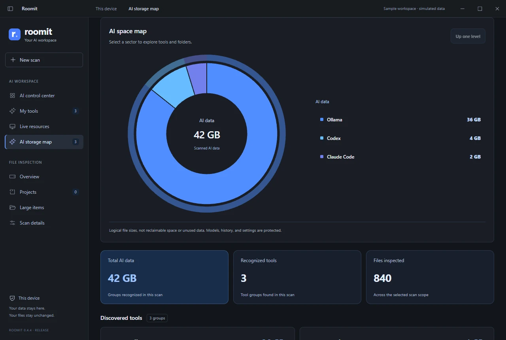
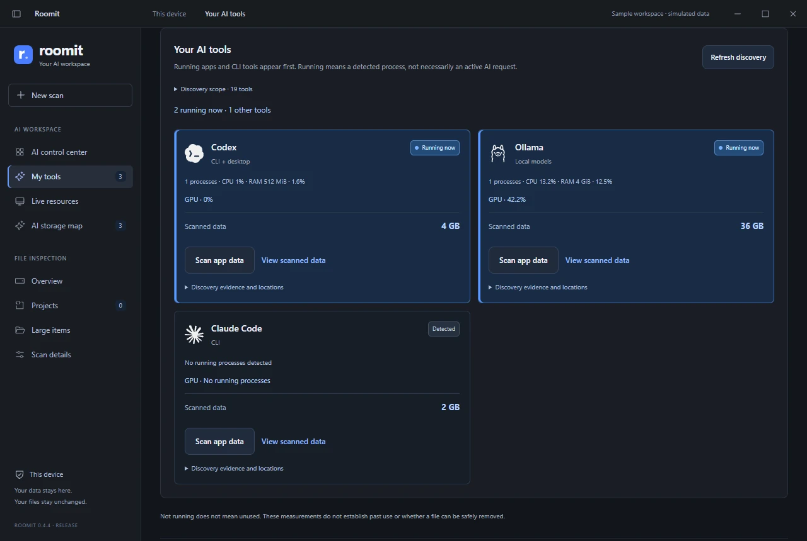
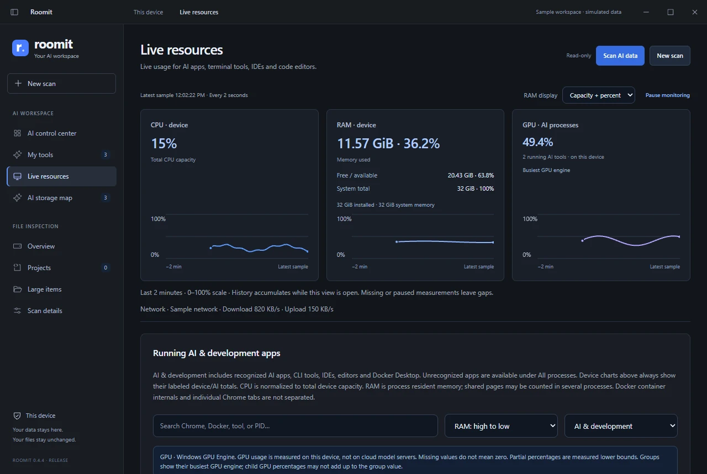

# Roomit

Find out how much disk space your AI tools use. Roomit measures model libraries, chat history and other tool data locally on Windows and Apple Silicon Mac. You can open any reported location in Explorer or Finder.

**[Download for Windows](https://github.com/tolgacetinkaya/roomit/releases/latest)** · **[Download the Apple Silicon test DMG](https://github.com/tolgacetinkaya/roomit/releases/download/v0.4.4-macos-test.1/Roomit-0.4.4-macos-arm64.dmg)** · [Installation and updates](#installation-and-updates)

[](docs/media/sample-storage.webp)

**Where did the space go?** In this example, Ollama uses **36 GB** of the **42 GB** scanned. Codex uses **4 GB** and Claude Code uses **2 GB**. Select a sector to explore the folders behind that number. These are logical sizes. A large folder can still contain models or conversations you use every day.

All screenshots show the v0.4.4 interface with fictional data. The storage sizes, running apps and resource readings come from the same sample workspace.

## Try it with one tool

1. Open **My tools** and find a tool you use, such as Codex. A **Running now** badge means Roomit detected a local process.
2. Choose **Scan app data** on its card. Roomit measures that tool’s known data folders. You can start here even if you have several disks.
3. Open **View scanned data**, pick a folder, then choose **Show in folder** to inspect it yourself. To compare multiple tools in one map, choose **Scan AI data**.

<details>
<summary><strong>See how running and detected tools appear</strong></summary>

In the example, Ollama and Codex are running. Claude Code is also present and has 2 GB of scanned data. Each card separates current activity from storage measured during a scan.

[](docs/media/sample-tools.webp)

Roomit has discovery rules for 19 tool families, including Claude Code, Codex, OpenCode, Ollama, LM Studio, Cursor, Qwen, Kimi and ZCode. Expand **Discovery evidence and locations** to see whether Roomit found an installation, command or data folder. Custom installations can fall outside these rules. Use **New scan → One folder** for a model library stored elsewhere. [Discovery guide](docs/AI_WORKSPACE.md) · [Per-app scans](docs/APP_DATA_SCANS.md)

</details>

## What is using resources right now?

Open **Live resources** without starting a disk scan. The CPU and RAM charts cover the whole device. The Windows GPU chart shows activity for recognized local AI processes. Expand an app in **Running AI & development apps** to inspect its individual processes.

<details>
<summary><strong>See the live charts and what they measure</strong></summary>

[](docs/media/sample-resources.webp)

Charts retain up to two minutes of samples, taken about every two seconds while monitoring is active. RAM can be displayed in GiB, as a percentage or both. Network rates apply to the selected adapter. GPU readings can be partial or unavailable, and the Mac test build shows GPU as unavailable. [Measurement details](docs/LIVE_RESOURCES.md)

</details>

## Explore the rest of a scan

| If you want to… | Open | What to look for |
| --- | --- | --- |
| See which repositories account for development files | **Projects** | Dependency folders and build output grouped under recognized projects. |
| Find large folders or individual files | **Large items** | Set a minimum size in GB, then browse the matching folders or files. Folder totals already include their contents. |
| See how much of a scan finished | **Overview** or **Scan details** | Totals, inspected locations and any folders Roomit could not read. |

Choose **New scan** to inspect a folder, disk or whole computer. You can exclude personal folders, follow progress or cancel. The latest results stay on your device when you close Roomit. If a watched folder changes while Roomit is open, you can choose when to rescan. [Scan scopes, exclusions and saved results](docs/SCANNING.md)

## Installation and updates

| Platform | What to download |
| --- | --- |
| Windows x64 | Choose the **portable EXE** to run Roomit directly, or the **setup EXE** for a per-user installation. Both require WebView2. [Downloads and checksums](https://github.com/tolgacetinkaya/roomit/releases/latest) |
| Apple Silicon Mac, macOS 13+ | Open the **arm64 DMG**, drag Roomit into **Applications**, eject the disk image and launch the app. The test build is ad-hoc signed and has not been notarized. [Download the DMG](https://github.com/tolgacetinkaya/roomit/releases/download/v0.4.4-macos-test.1/Roomit-0.4.4-macos-arm64.dmg) · [First launch and Mac testing](docs/MACOS-TESTING.md) |

Roomit checks GitHub for published updates. You can also select **Roomit → Check for updates**. On Windows, portable users can download the latest portable EXE or approve running the installer. Windows packages have no Authenticode publisher certificate. Roomit verifies updater signatures separately. [Update guide](docs/RELEASING.md)

## Privacy

Roomit requires no account or AI API key. Classification uses file metadata such as paths, types and sizes. Source code and conversation contents stay private. Scans are read-only and the index stays on the device. Network access is used for update checks, downloads and links you open.

## Build and contribute

Install Node.js 22.18+, Rust and the [Tauri platform prerequisites](https://v2.tauri.app/start/prerequisites/). Start the desktop app with:

```sh
git clone https://github.com/tolgacetinkaya/roomit.git
cd roomit
npm ci
npm run tauri -- dev
```

Detection fixtures, reports of misidentified tools and Mac test results are welcome. When sharing screenshots or logs, redact usernames and local paths. [Contribution guide](CONTRIBUTING.md) · [Architecture](docs/ARCHITECTURE.md) · [Validation](docs/VALIDATION.md) · [Roadmap](docs/ROADMAP.md) · [Report an issue](https://github.com/tolgacetinkaya/roomit/issues/new/choose)

## License

[MIT](LICENSE). Tool names and logos identify their respective products. [Tool artwork notices](src/assets/tools/LICENSE)
