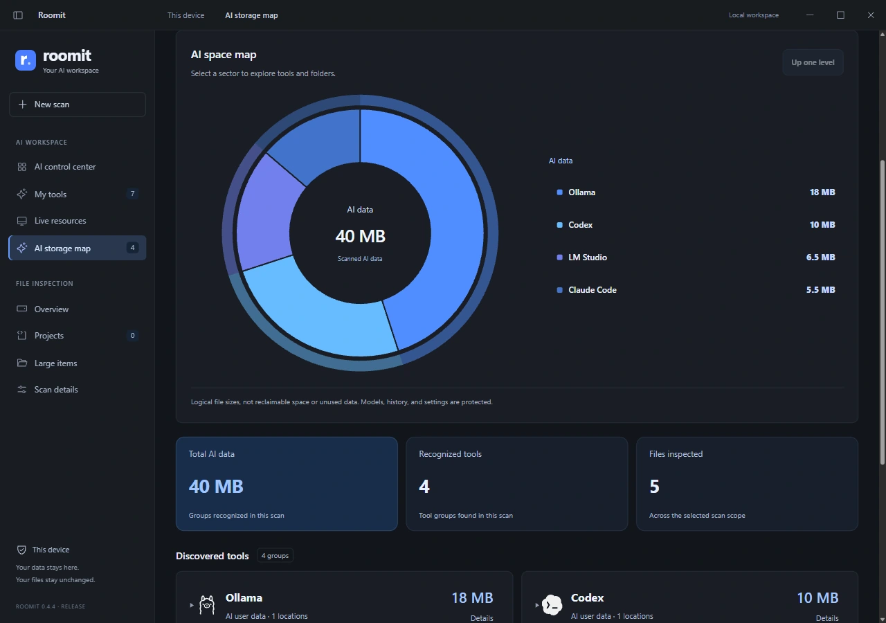
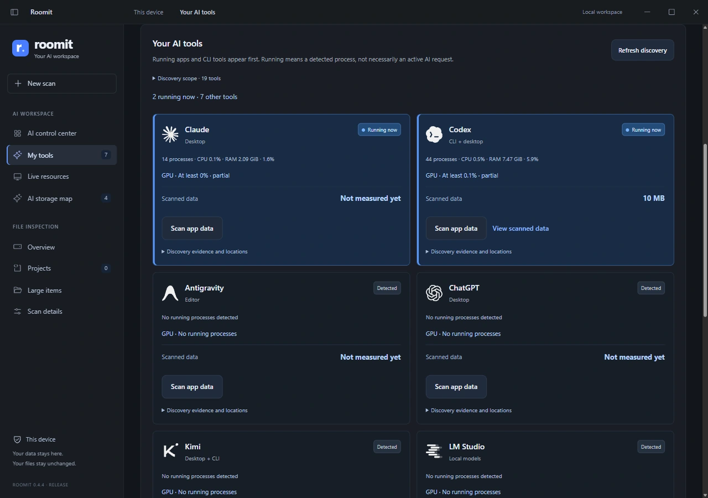
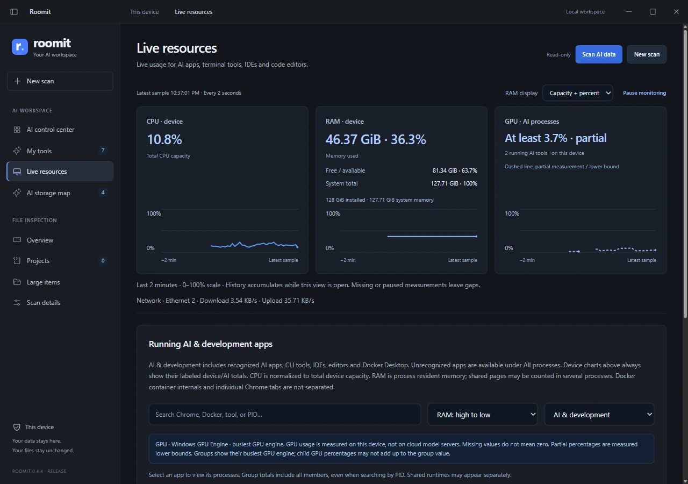
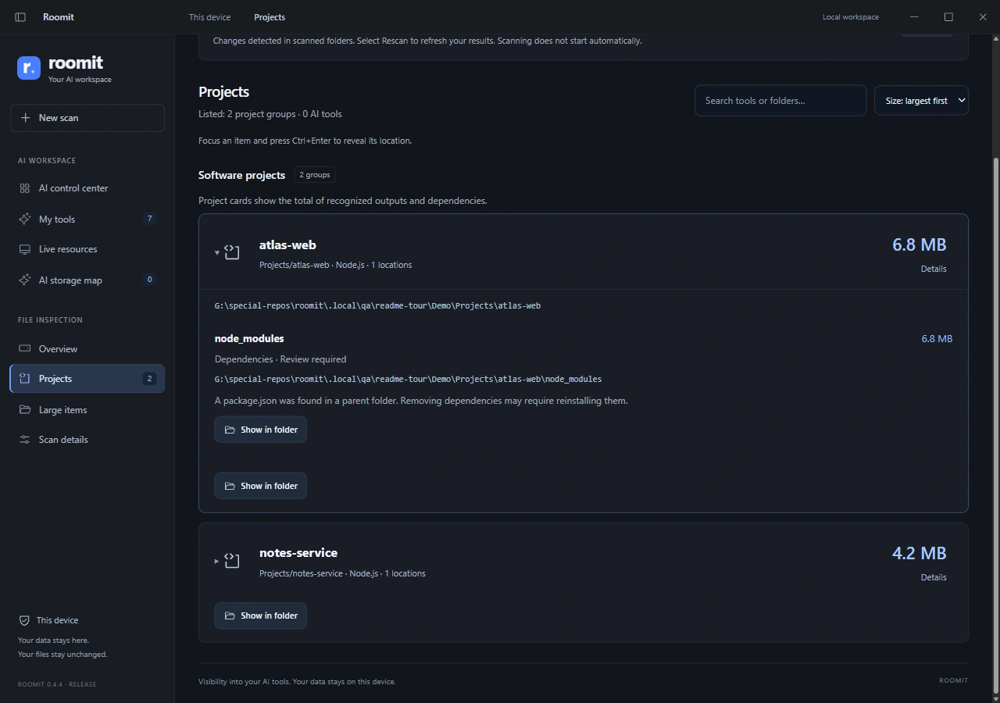
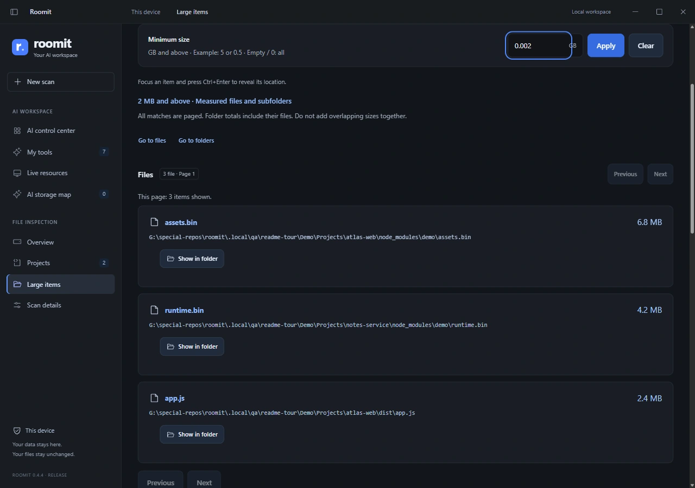

# Roomit

Roomit shows which AI tools are on your computer, how much space their data uses and what they are doing right now. Pick a tool such as Codex, Claude Code or Ollama, measure its folders and open the location in Explorer or Finder. Scans run locally and leave your files in place.

**[Download for Windows](https://github.com/tolgacetinkaya/roomit/releases/latest)** · **[Download the Apple Silicon test DMG](https://github.com/tolgacetinkaya/roomit/releases/download/v0.4.4-macos-test.1/Roomit-0.4.4-macos-arm64.dmg)** · [Install and update](#install-and-update) · [Build from source](#build-and-contribute)

[](docs/media/ai-storage-map.webp)

*One scan, four tools, five files. Ollama accounts for 18 MB of the 40 MB in this sample workspace. The screenshots in this guide show the Windows v0.4.4 interface. Select any image to see the full window at its original size.*

## Start with one AI tool

1. Open **My tools** in the sidebar. Roomit looks for supported desktop apps, CLI commands and known data folders. Expand **Discovery evidence and locations** on a card to see what it found.
2. Choose **Scan app data** on that card. Roomit measures the tool’s known user-data folders and shows their combined size under **Latest app scan**. This is a useful first scan on a machine with several disks.
3. Choose **View scanned data** to open **AI storage map**. Select a sector to explore it, then use **Show in folder** on a result to inspect its location. You can also focus a result and press **Ctrl+Enter** on Windows or **⌘+Enter** on Mac.

[](docs/media/my-tools.webp)

To compare tools as in the opening screenshot, choose **Scan AI data**. A model library you moved to a custom drive can be inspected separately with **New scan → One folder**. [Per-app scan guide](docs/APP_DATA_SCANS.md)

### Which tools can Roomit find?

| Tool family | Bundled discovery rules |
| --- | --- |
| Coding assistants and editors | Codex, Claude Code, OpenCode, Cursor, Windsurf, Gemini CLI, Aider, GitHub Copilot, Antigravity, Trae |
| Local models and AI workspaces | Ollama, LM Studio, Jan, AnythingLLM |
| Other desktop and CLI tools | Claude, ChatGPT, ZCode, Qwen, Kimi |

A data folder can outlive the application that created it. The evidence on each card helps distinguish a leftover folder from an installed command or app. Automatic discovery covers known locations for these 19 families. Custom aliases, WSL or container installations and browser-only AI tools can fall outside that coverage. [Request support for a missing tool](https://github.com/tolgacetinkaya/roomit/issues/new?template=03_tool_support.md)

## Watch live CPU, RAM and GPU

Open **Live resources** at any time, including before your first disk scan. The charts cover up to two minutes of readings, sampled roughly every two seconds while monitoring is active. The **Running AI & development apps** table puts AI tools and editors together. Switch the filter to see all processes, search by name or PID, or sort by resource usage. Expand an application group to see how individual processes contribute to its totals.

[](docs/media/live-resources.webp)

| Reading | What it tells you |
| --- | --- |
| CPU | Device utilization and each process’s share of total CPU capacity. |
| RAM | Used, available and OS-visible total memory in GiB. Choose amounts, percentages or both. Process rows show resident memory, which can include shared pages. |
| GPU | On Windows, activity on the busiest measured GPU engine for recognized local AI processes. Partial readings are lower bounds. The Mac test build marks GPU as unavailable. |
| Network | Download and upload rates for the selected network adapter. These are adapter-wide measurements. |

The **AI control center** brings the resource cards, detected tools and measured AI storage together. **My tools** puts running tools first. Pausing monitoring or leaving the resource views stops sampling. Gaps in a chart indicate missing samples. [Measurement details](docs/LIVE_RESOURCES.md)

## Inspect projects and large files

Choose **New scan** and select a scope. **One folder** includes its subfolders, **One disk** covers the selected volume, and **Whole computer** covers detected local disks. Review **Exclusions** before starting. Roomit skips supported system and installation paths automatically and remembers folders you exclude yourself. Progress and cancellation are available during a scan.

### Projects

Scan a folder that contains your repositories, then open **Projects**. Roomit uses project markers and groups recognized items, such as dependency folders and build output, under their project. In the example below, expanding **atlas-web** shows that its **6.8 MB** comes from `node_modules`. The separate **notes-service** project accounts for another **4.2 MB** of recognized items. For a complete measured folder size, use **Large items**.

[](docs/media/projects.webp)

### Large items

Enter a minimum size in GB and choose **Apply**. Files and folders have separate results. You can change the threshold, search and page through matches using the existing scan. In this example, a threshold of **0.002 GB** finds files of **2 MB** and above in the two sample projects. Folder totals include their children, so adding a folder and its files would count some bytes twice.

[](docs/media/large-items.webp)

### Overview, scan details and saved results

**Overview** summarizes the latest scan. **Scan details** shows the inspected locations, coverage and warnings. Inaccessible folders or cancellation can leave partial totals. The reported sizes are logical file sizes. They tell you where space is accounted for, without establishing that a model, history or dependency is safe to remove.

Roomit saves the latest scan and its size index locally, including partial results from a cancelled scan. Reopen the app to browse them again. While Roomit is open, changes detected in the scanned folders can mark the results as out of date. **Rescan** is your choice. [Scan scopes, exclusions and saved results](docs/SCANNING.md)

## Install and update

| Platform | Package and first launch |
| --- | --- |
| Windows x64 | Get the **setup EXE** for a per-user installation or the **portable EXE** to run directly. WebView2 is required. [Windows downloads and SHA-256 hashes](https://github.com/tolgacetinkaya/roomit/releases/latest) |
| Apple Silicon Mac, macOS 13+ | Open the **arm64 DMG**, drag **Roomit** into **Applications**, eject the disk image and launch Roomit from Applications. The test build supports M1 and newer chips, including M4. [Download the test DMG](https://github.com/tolgacetinkaya/roomit/releases/download/v0.4.4-macos-test.1/Roomit-0.4.4-macos-arm64.dmg) |

**Trying it on a MacBook?** Start with one AI app, check the measured size, open its folder in Finder and reopen Roomit to check the saved result. CPU and RAM are available on Mac. The test app uses an ad-hoc signature and has not been notarized by Apple. The Mac guide covers first-launch prompts and how to report an issue with your macOS version and redacted paths. Interactive M4 testing and a Mac version-to-version update remain pending. [Mac testing guide](docs/MACOS-TESTING.md) · [Mac release notes](https://github.com/tolgacetinkaya/roomit/releases/tag/v0.4.4-macos-test.1)

Roomit checks GitHub for published updates. Use **Roomit → Check for updates** to check manually and review the update before installing. On Windows, portable users can choose **Download latest portable EXE** or approve running the installer. The Windows executables ship without an Authenticode publisher certificate. Updater signatures are verified separately. [Update behavior and signatures](docs/RELEASING.md)

## Privacy

Roomit needs no account or AI API key. The scanner inspects file metadata, including paths, types and sizes. Your source code and conversation contents stay out of classification. Roomit keeps the scan index on your device and provides read-only inspection. Network access is used for update checks, downloads and links you choose to open.

## Build and contribute

Install Node.js, Rust and the [Tauri platform prerequisites](https://v2.tauri.app/start/prerequisites/), then:

```sh
git clone https://github.com/tolgacetinkaya/roomit.git
cd roomit
npm ci
npm run tauri -- dev
```

Use Node 22.18+ for the native TypeScript tests and a Rust toolchain compatible
with the workspace's minimum version. Windows also needs C++ build tools, the
Windows SDK and WebView2. `npm run dev` is a frontend preview; native scanning is
only available in the desktop app.

Useful contributions include detection rules with fixtures, false-positive
reports, accessibility improvements and Mac validation. Changes go through a
**feature branch → tests → pull request → review → merge** workflow.

[Contribution guide](CONTRIBUTING.md) · [Proposed roadmap](docs/ROADMAP.md) ·
[Issue templates](https://github.com/tolgacetinkaya/roomit/issues/new/choose)

## Documentation

- [AI workspace and discovery](docs/AI_WORKSPACE.md)
- [Per-application data scans](docs/APP_DATA_SCANS.md)
- [Live resources and measurement limits](docs/LIVE_RESOURCES.md)
- [Scan sizes, exclusions and saved results](docs/SCANNING.md)
- [Architecture](docs/ARCHITECTURE.md)
- [Validation](docs/VALIDATION.md) and [manual checks](docs/MANUAL_TEST.md)
- [Release process and updates](docs/RELEASING.md)

## License

[MIT](LICENSE). Tool names and logos identify their respective products; Roomit
is not affiliated with those vendors. See the [tool artwork notices](src/assets/tools/LICENSE).
